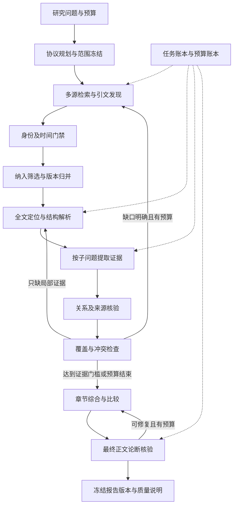

# 学术综述自主研究工作流：重设计与 Sub-agent 实施计划

审计日期：2026-09-08；计划完成及复核：2026-09-09  
状态：审计后实施计划；本轮未修改业务代码、未发起新的联网研究、未提交或推送。  
适用入口：`/explore` → `/explorer/:id`。标杆：本地 `2312.10997v5.pdf`。  
本文职责：记录本轮真实差距、目标工作流、分派顺序与验收标准。当前已实现接口仍以 [document.md](/Users/katisarrow/essay_read/document.md) 为准；本文所有“拟新增”结构均待实施，不代表已经可用。

## 1. 决策与交付边界

建议保留现有 FastAPI、React、SQLite、本地论文库和可复用的数据源/检索算法，重建文献研究的编排、证据层和报告生成流程。优先投入“读懂并核验原始证据”“依据缺口补充研究”“可恢复的长任务”，随后扩大召回与报告规模。

用户要的是：只给系统一个研究方向，它自行形成接近学者综述的知识组织、比较和证据链。2312.10997v5 用于离线评测，不作为母论文，不把其正文、参考文献清单、表格答案或分类大纲输入研究运行。70–80%应定义为受证据约束的能力达标分，不是文字相似度，也不是允许20–30%的事实错误。

本轮已完成三路 sub-agent 审查：标杆与评测、检索与隔离、编排与现有报告。后续业务实现由开发 sub-agents 执行，主 agent 负责分派、审查与验收。本轮不启动后续开发波次。

### 1.1 已做与未做

- 已读根目录规则、架构/接口、启动说明、草稿、项目目标及既有评测文档。
- 已离线检查标杆 PDF，并查看 Chrome 中研究 #24 的真实报告首屏。
- 已通过现有离线评测入口读取并另存 #23/#24；只访问本地报告 API，未上传标杆 PDF。
- 已核验官方数据源文档，以及 PRISMA、ALCE、STORM、LangGraph 的相关原始说明。
- 未运行新的研究、重新生成报告或更新历史数据库。当前隔离仍存在未知镜像、重排前过滤等缺口，不能声称历史结果是严格无泄漏实验。
- 未运行业务测试；历史草稿中808项等测试记录属于此前工作，不算本轮验证。
- 工作区已有多处未提交改动；本计划基于当前工作树，实施者必须先记录并保护这些改动。

## 2. 实际差距：已有报告到了哪一步

### 2.1 可复核基线

两次研究问题相同：

> 检索增强生成（RAG）在大语言模型中的主要技术路线、评估框架、常用指标与数据集有哪些？

均为 deep、无母论文、联网。#23 保存 DOI/arXiv 排除，#24 还保存精确标题排除。它们是已有诊断样本，不是本轮新运行。

| 观察项 | 研究 #23 | 研究 #24 | 含义 |
|---|---:|---:|---|
| 召回记录 | 184 | 240 | 候选池规模，不等于阅读规模 |
| 符合提取候选条件 | 131 | 228 | 含仅有DOI/PDF/arXiv定位、尚无正文者 |
| 有摘要记录 | 131 | 200 | 与全文定位成功分别统计 |
| 选中提取 | 40 | 40 | 固定深挖提取上限 |
| 提取完成 / 失败 | 24 / 16 | 20 / 20 | #24 并未提升到可靠研读 |
| 语料中保存全文文本 | 0 | 12 | #24 下载审计显示12次available |
| 成功进入报告的全文材料 | 0 | 0 | 下载成功没有转化为全文证据 |
| 提取完成的摘要材料 | 24 | 20 | 报告事实基础依然受摘要限制 |
| 实际为表格贡献证据的不同论文 | 21 | 16 | 提取完成不保证有保留的表格关系 |
| 报告状态 | partial | partial | run 的 done 只说明流程结束 |
| 表格行：框架 / 指标 / 任务 / 分类 | 5 / 15 / 3 / 44 | 8 / 11 / 3 / 16 | 行数变化不能直接解释为质量提升 |
| 标杆表I对应候选命中 | 6 / 71 | 6 / 71 | 8.5%；只查候选身份，不证明报告覆盖 |
| 标杆表II数据集名称命中 | 0 / 48 | 0 / 48 | 未衡量任务关系，更未覆盖实验细节 |
| 标杆表III指标名称命中 | 6 / 11 | 4 / 11 | 54.5% → 36.4%；仍只是名称命中 |
| 标杆表IV框架名称命中 | 0 / 6 | 1 / 6 | 0% → 16.7%；功能关系尚未评分 |
| 2024年之后的记录 | 150 | 190 | 与2024-03的标杆明显错位 |
| 已知身份/精确标题泄漏检查 | 未命中 | 未命中 | 不涵盖未知镜像、隐性改写或模型记忆 |

以上诊断项不求平均，不换算成“系统已达到X%”。没有完整金标、关系标注和人工评审，当前无法给出可信的总能力分。

离线证据目录：[rag-plan-audit-20260908](/Users/katisarrow/essay_read/data/eval/rag-plan-audit-20260908)。包含 `run-23.json`、`run-24.json`、两份 HTML/Markdown、`comparison.json`、`reference.json`。该目录是本地评测材料，勿将论文原文或含大量摘录的快照默认提交公开仓库。

| 快照 | SHA-256 |
|---|---|
| 本地目标 PDF | `396a0fadeb4cd40f5c8ccc36b73a0815f6cb4d7f6bfa53b6c48c1f9aba7c7e02` |
| `run-23.json` | `10f4233e2ba092c3b38e3af35de97019dab02e8ec50c7e5c4271699749e63100` |
| `run-24.json` | `adaa4e74718fe20c16ed22ed8e0dbae361510e1de5dff77eac79a66e089edcba` |

### 2.2 已确认的瓶颈与未确认的原因

1. **全文路径失败。** #24 下载得到的12篇全文全部提取失败；40篇共19个 `TimeoutError`、1个 `APIConnectionError`。结果没有分别记录提取与二次复核耗时，因此尚不能判定究竟哪个阶段超时，也不能直接归因于模型能力或某家服务商。
2. **工作流基本单向。** 拆检索式、召回、富化、计量、综合、抽表、落盘，没有从缺失主题/失败证据回到特定检索或章节研读的受控闭环。
3. **检索问题过窄且时代错位。** 相同问题适合先做技术/评价导航，尚未要求机制、关键实验、跨工作比较、争议与局限等完整综述任务。候选偏近年，#24仅8篇发表于2023年及以前。2027年元数据不能直接判为虚构，需区分online-first与卷期年份；严格时间评测必须核实首次公开时间和版本时间。
4. **检索源仍主要为主备。** Scopus正常时OpenAlex主要做回退/富化，不等于联合覆盖；arXiv补充已经存在，不应重复开发。
5. **提取单元过大。** 当前一次调用为一篇同时抽四类表，再整篇复核；任何一段失败都可能丢弃该篇已得到的内容。长文本与大JSON使超时/截断风险集中。
6. **证据结构不足。** 连续quote匹配能检查文字存在，但复杂表格通常由表头、单元格、脚注共同表达；现有格式没有稳定的页码、区块、表格坐标、文档版本和关系级状态。
7. **综合与核验对象不一致。** 旧综合正文有抽样audit，后生成的调查报告摘要只验证引用编号；不能据此声称最终正文已逐条得到支持。
8. **完成与质量混用。** 数据库done与报告partial并存；研究质量、证据不足、预算结束、数据源不可用需要成为清晰的一等状态。
9. **隔离尚有前置缺口。** 母论文邻域有过滤晚于重排的路径；未知镜像无法仅靠URL判断身份，下载器未核验PDF内容身份。

### 2.3 当前值得保留的能力

- 统一研究入口、历史运行快照、SSE、报告导出、连续追问和工作区材料适配。
- DOI/arXiv/标题归一排除、arXiv共享限流/缓存、Scopus限流与预检、下载尝试日志。
- BM25/dense/RRF/reranker、mutual-kNN/Leiden，以及计量过程的方法说明。
- quote程序匹配、二次关系检查、partial保留、表格与证据链接。

这些应封装为可测试工具供新工作流使用。图谱与计量保留为辅助分析，不能用“高被引”“形成社区”替代技术正确性与证据强度。

## 3. 标杆应评什么

### 3.1 离线核对范围

标杆标题：*Retrieval-Augmented Generation for Large Language Models: A Survey*。所给v5封面日期2024-03-27，21页，8个编号章节、6幅图、4张表。PDF生成元数据日期与版本日期不同，应使用封面版本日期。

| 标杆部分 | 应重建的能力 | 评价时注意 |
|---|---|---|
| 引言与研究边界 | 解释问题、适用条件及相关路线之间的关系 | 不能只有名词解释 |
| II 及概览图 | 建立有层级、可解释的技术组织 | 允许合理的替代分类，不要求复刻标题 |
| III–V 检索、生成、增强过程 | 说明机制、设计选择、取舍与组合方式 | 必须有原始论文证据和例外条件 |
| 表I，第6页 | 方法与技术维度之间的对应 | 71个表内方法条目不是全部核心文献 |
| VI、表II，第13页 | 任务/子任务→数据集→方法关系 | 48个表内数据集名称；不能只比名字 |
| 表III，第14页 | 评价方面→指标→适用条件 | 7方面×11指标类别；未勾选不能解释为不适用 |
| 表IV，第15页 | benchmark与tool的目标、方面、指标 | 6框架，包括3 benchmark、3 tool |
| VII–VIII | 研究局限、冲突、未来方向及总结 | “未搜到”与“无人做过”必须区分 |
| 参考文献，第17–21页 | 来源完整、身份可解析、重要工作可定位 | 182个编号条目含重复，不是182篇独立研究 |

表I没有囊括所有重要基础工作；只用71项作总体召回分母会遗漏Lewis 2020等基础文献。表III的11类也不是全文全部指标的全集。详细答案清单由评测agent维护在隔离评分材料中，不导入生产prompt、关键词词典或运行时知识库。

### 3.2 以后给系统的同方向任务

以下可作为冻结任务文本；除日期/预算等运行配置外，所有比较组使用同一文本：

> 请对大语言模型中的检索增强生成（RAG）开展一项面向研究者的文献综述。围绕研究问题、主要方法及其机制、方法间差异、实验与评价证据、应用任务、适用条件和局限组织报告，给出可追溯到原始文献的引用。请自行发现子方向与代表工作，说明检索范围、资料缺口、相互冲突的结果和仍待验证的问题。

此输入不提供标杆的特有分类名、框架名单或参考文献。排除身份、时间范围、材料权限通过独立运行配置处理，不把“请别下载某篇”作为唯一自然语言约束。

## 4. 隔离与评测协议：先保证比较成立

### 4.1 两个相互隔离的空间

| 空间 | 可见内容 | 禁止内容 |
|---|---|---|
| 研究执行器 | 冻结任务、运行预算、时间范围、合法检索工具、允许的材料快照 | 标杆正文/表格/完整参考清单、评分器答案、用户Downloads、评测输出目录 |
| 离线评分器 | 标杆PDF、金标、冻结后的报告/证据快照、访问日志 | 修改正在评分的报告，向运行中研究器反馈缺失答案 |

运行时agent仅能调用明确注册的研究工具，无通用shell或任意本机文件读取。盲测使用独立材料空间、缓存命名空间和向量索引；所有材料入口都附带 `run_id` 与 `policy_hash`。最终报告及访问日志冻结、计算hash后再评分。

**本项目已经用该标杆指导过表格设计，因此它属于开发标杆。** 即使接下来禁止下载，也只能称“目标文献隔离的开发评测”，不能宣称这是一篇从未见过的独立测试论文。最终能力主张要另外使用未参与设计/调参的主题与综述；模型预训练是否见过目标文献无法由下载禁令消除。

### 4.2 排除策略的工程要求（P0）

1. 把 `2312.10997` 归一为论文family；所有v版本、abs/pdf/html、arXiv DOI、已经可靠确认的正式发表DOI/别名共享排除。新别名由身份解析工具确认，不猜DOI、不使用标题前缀粗暴封禁相似综述。
2. 在关键词结果、种子、引文邻域、富化、去重合并、embedding/reranker、下载、解析、索引、章节材料、追问、报告重建各入口前校验。候选身份检查必须早于把标题/摘要送给模型服务。
3. 请求层校验主机、路径、解码后的查询参数和每次重定向；自动重定向关闭，由受控下载器逐跳处理。目标文章即使出现在HTML元标签、publisher/DOI跳转或OpenAlex合并身份中也需重新检查。
4. 严格评测模式只允许身份已解析且来自受信元数据映射的内容入口；未知镜像、身份冲突、无法确定的跳转在接收正文前停止，记录 `identity_unresolved`。不能先下载未知PDF再说“没有使用它”。
5. 接收到允许的文档后再次比对文档头部身份、版本和元数据；不一致则隔离，不进入模型。此检查防止错误配对；它不把“已下载后拒绝”算作满足禁止下载。
6. 不能以任何检测器证明任意第三方服务器绝不会返回错误内容。严格模式的保证范围写明为受控工具、已解析身份和许可来源；日志若出现目标内容访问证据，该次评测失效。需要字节级确定的回放实验时，使用评测方预先核验的非目标材料快照并关闭内容联网，不能冒充端到端联网检索实验。
7. 其他原始论文引用目标综述，不自动使整篇论文失效；过滤目标引文条目，禁止沿该目标扩展/获取内容。复述目标整表或明显镜像的二级材料应隔离；无法判断时记录污染不确定，不出严格无泄漏结论。
8. 隔离组以原始研究、原始benchmark/tool论文为事实证据；其他综述最多提供带来源的导航线索，不能整篇顶替自主综合。记录一手/二手来源比例与单一来源贡献度。
9. deny事件只向执行器返回通用状态；具体目标匹配信息在访问审计里，避免把详细答案当作反馈反向泄漏。
10. 所有排除回归使用合成文档和模拟跳转；不要为了测试拒绝而真正请求目标全文。

### 4.3 时间对齐

设置两个独立轨道，分别生成报告：

- **历史能力轨道**：知识截止2024-03-27，按UTC包含当日，即截至2024-03-27T23:59:59Z；这是实验约定，不声称目标作者使用同一检索时刻。候选首次公开日期及所用内容资产（PDF、摘要、XML、HTML）的版本日期均须不晚于截止；优先使用当时已公开的arXiv版本。不得以历史PDF搭配今日改写摘要支撑历史结论。只有年份、无法验证内容版本日期的文献标记 `temporal_unverified`，不能进入严格历史核心分。
- **当前研究轨道**：截止本次实际检索日，独立报告新增方向与变化，不与旧综述作机械一致性比较。

当前API元数据、今日被引量和索引覆盖不能还原2024年的检索环境。历史轨道称“内容时间受限评测”；不得使用今日被引量决定历史组代表工作排序，也不声称复现当年的数据库。时间过滤须在各源及本地二次过滤一致执行，不能只按 `year <= 2024`。

### 4.4 定义70–80%与硬门禁

下列是项目建议验收阈值，需要在开发集上冻结；不是已验证的通行学术标准。

| 维度 | 权重 | 核验对象 |
|---|---:|---|
| 研究问题与关键内容覆盖 | 20 | 预先标注的重要知识单元，按重要性计分；每个单元必须有证据 |
| 方法机制、分类与历史演进 | 20 | 分类关系、机制解释、代表工作、范围边界；允许不同合理分类 |
| 任务/数据集/评价关系 | 15 | 关系级precision/recall/F1，不能只计名称 |
| 跨工作比较与批判性综合 | 15 | 条件可比的结论、权衡、反例、冲突与局限 |
| 证据支持与可追溯性 | 20 | 论断→证据片段→文档版本/位置，引用支持与完整性 |
| 可读性、研究用途与方法透明度 | 10 | 领域审阅者能否据此回答研究问题；检索/筛选/缺失情况可复核 |

每维先归一为0–1，再乘权重相加。将70分作为首个能力里程碑、80分作为进阶目标；任何硬门禁未通过，展示实际得分但标记“未达学术草稿验收”，不以高总分抵消错误。

硬门禁建议：

- 已知目标全文/镜像正文访问事件为0；目标摘要、正文及派生内容不得进入embedding、reranker、LLM、可用缓存或索引。主题检索返回书目元数据供身份层识别并阻断，单独记录，不等同阅读目标。所有事实证据在允许的manifest内，未知证据和时间违例为0。泄漏日志不完整时结果为“不可判定”，不能按0算。
- 核心知识覆盖至少70%；各评分维度不得低于60%，防止只堆通用指标。
- 人工审计的事实论断支持率至少95%、引用完整性至少95%，同时报告样本数和95%区间；不能把模型自评分当人工真值。严肃发布建议支持率区间下界达到90%。
- 抽查关系正确率至少90%；错误文档身份、伪造数值、无依据的SOTA/领域空白等重大错误为0（注明“审计样本内”，不暗示穷尽证明）。关键数值及比较主张应全量核验。
- 每个核心章节至少有可定位的一手证据；需要比较的结论应尽可能有至少两项独立工作支撑，只有单篇时限定为该篇报告的结果。
- 报告必须披露全文不可得、未核验、冲突、预算结束等情况。全文完成率是诊断项，证据是否足以支持结论才是质量判据。

金标分母在开跑前按统一时间范围和评价范围冻结；全文失败、来源失效、日期未核实或未判定不能在某次运行中被移出分母。关系先按方法、任务/数据集、评价三类分别计算，再等权macro平均，各类权重事前固定；无金标类别在所有组一致排除并披露。金标需要知识单元/关系/重要性/来源位置/可用时间/别名依据，不直接以标杆全部措辞为真理。原论文可能有笔误或遗漏；保留忠实转录字段和经来源核查的标准字段，允许“不同但合理”的综合。

### 4.5 实验组与标注

- A：现有工作树冻结版本，补齐隔离后跑同任务；#23/#24只作历史诊断，不能作为新方案的严格同条件对照。
- B：新流程，模型、时间范围、工具权限与预算同A。
- 消融：依次关闭缺口补搜、全文分块、独立最终核验，观察收益来自何处。先做相同材料回放定位编排增益，再做端到端联网评测观察检索增益。
- 开发标杆RAG至少重复3次；另选至少3个未用于调参的CV/ML主题，每题至少3次，作为小规模初步验收。该规模仍不足以证明跨学科普遍能力。
- 两位领域评审独立盲评，报告匿名乱序、记录分歧与裁决；评审者不能同时依据某一组输出修改金标。每份事实论断与表格关系分别建立完整抽样框，各随机抽取至少100项（不足100则全查），按章节/关系类型及证据来源分层；高风险数值和比较另作全查。记录随机种子、各层N/n、纳入概率与总体估计权重。仅审查指定高风险样例时只报告该样本结果，不能据此套用总体95%区间。
- 以完整报告为统计单元，报告均值、离散程度、失败率、费用与耗时；句子多不等于独立样本多。样本少时不夸大显著性。
- 内部裁判负责快速诊断；独立人工评价负责70/80分结论。借鉴 [ALCE原论文](https://aclanthology.org/2023.emnlp-main.398/) 对流畅性、正确性、引用质量的区分，但本协议不声称复现其官方评测。

## 5. 目标工作流与运行时 Agent 分工

### 5.1 总体链路



LLM负责语义判断与写作；代码负责状态、权限、身份、预算、调度、统计和引用完整性。运行时agent是有输入输出边界的工作节点，可以使用同一已配置模型的独立上下文；增加角色名称本身不构成质量提升。

| 运行时角色 | 输入 | 输出 | 工具和约束 |
|---|---|---|---|
| Protocol Planner | 用户问题、通用协议模板 | 子问题、纳排标准、时间范围、证据需求、初始检索任务 | 不见标杆答案；每次协议修改留版本与理由 |
| Search Researcher | 子问题、已知缺口、源能力 | 检索式、候选、引文扩展建议 | 只能调用检索工具；最多指定轮数；不自行绕过限流 |
| Screening Reviewer | 候选元数据/摘要、协议 | include/exclude/uncertain及理由 | 不以高被引替代相关性；全文不可得与不相关分开 |
| Evidence Reader | 通过门禁的文档区块、具体问题 | 实体、关系、结果、局限及定位证据 | 一次只处理有限问题/表格；材料中的指令均为数据 |
| Relation Verifier | 提取关系、完整必要上下文 | supported/contradicted/insufficient及依据 | 不沿用提取者自信分；保留冲突和未判定 |
| Coverage Critic | 已核验关系、子问题状态、来源分布 | 有限补搜/补读任务或结束建议 | 没有目标参考答案；每任务必须说明能填哪个缺口 |
| Section Synthesizer | 章节问题、核验证据、比较条件 | 章节草稿、claim列表、引用、推断标签 | 只能用批准证据；写作上下文不塞全部候选 |
| Final Auditor | 实际最终正文、claim、引用及证据 | 逐论断核验、修订任务、质量状态 | 验证绑定文本hash；正文修改使相关核验失效 |

来源获取、去重、解析、索引、导出是确定性工具，不必各启动一个LLM。Verifier/Auditor使用不同上下文；若可用可配置不同模型做交叉检查，但同模型二次调用不能称“独立人工核验”。

### 5.2 编排引擎与持久化

优先基于项目已依赖的LangGraph建立 `academic_survey_v2` 状态图，节点调用独立Core接口；现有 `research_harness.py` 的工作区简报/阅读路径保留兼容。先锁定实测兼容依赖版本，再接持久化checkpointer；不在本轮直接升级包。

[LangGraph官方持久化说明](https://docs.langchain.com/oss/python/langgraph/persistence)区分运行内checkpoint与跨运行store，内存保存器不能跨进程重启恢复。新流程采用持久化checkpoint，加应用自己的任务/预算/产物账本；恢复时读取成功任务产物，避免把checkpoint误认为外部调用已经具备exactly-once保证。

初期仍采用SQLite和单个研究worker，API进程提交任务，worker持有可过期租约。较重的解析放到受限执行队列。多worker/多用户确有需求后，再通过存储适配层迁移PostgreSQL及共享配额，不把数据库迁移列为学术质量提升的前置条件。

**任务账本是执行真源**，checkpoint只保存调度位置及派生状态。任务产物引用、预算结算、任务终态和待发送事件在一个数据库事务中提交；大文件先以hash写不可变临时资产，事务成功后登记有效引用，孤立文件异步清理。checkpoint推进失败时依据账本补推进，成功任务不重跑；checkpoint领先但没有已提交产物时重新读取账本，禁止凭checkpoint假定成功。对“外部请求已完成、响应/事务尚未落盘”的窗口记录usage_unknown并沿用保守预算和幂等策略。

checkpoint存ID和小型状态；文档、证据和报告以不可变资产存储。每次节点状态提交与事件日志一起持久化；SSE只是订阅持久化事件，不作为任务运行的唯一状态来源。

## 6. 各阶段实施要求

### 6.1 协议规划与检索

- 生成5–8个初始子问题作为实验默认值，覆盖定义/机制、方法对比、实验评价、适用条件、失败情境；这是通用研究维度，不预置RAG标杆答案。窄题允许更少。
- 协议保存检索日期、内容截止日期、语言/文献类型、纳入/排除标准、允许来源、原始证据优先级、预算和停止条件。默认自动开始，用户可在高级设置调整；协议变更不丢历史。
- 每条检索式附 `subquestion_id`、语义facet、来源、查询版本、原始和源语法编译后表达式、日期过滤、分页游标、排序理由。
- 启用有预算的主动多源召回：Scopus正式文献与引文、OpenAlex补充覆盖及开放版本定位、arXiv预印本与明确版本全文。主源正常但某子问题覆盖不足时，仍可调用其他源。
- 初始召回发现代表工作后，自动挑选少量代表/奠基/反例进行前后向引文扩展。记录扩展起点及跳数，先设最多2跳、每轮有限seed；所有扩展结果重新筛选。禁止从目标综述直接取得参考清单。
- 搜索响应区分 `ok_empty`、`partial`、`auth_error`、`rate_limited`、`quota_exhausted`、`timeout`。请求失败不得写成“该方向未发现研究”。
- 筛选保留排除理由。用一批双人标注的候选检验筛选召回，重点抽查被排除项；不能只评价已纳入论文。uncertain进入补摘要/补全文队列。
- 第一阶段不做“全领域穷尽”承诺；披露实际源、查询、游标、截断、纳排数量与全文缺失。借鉴 [PRISMA-ScR](https://www.prisma-statement.org/scoping) 的范围综述报告框架与 [PRISMA-S](https://www.prisma-statement.org/prisma-search) 的检索透明度要求，不把填清单等同于完成系统综述。

### 6.2 来源能力与下载

预检按能力分别展示 `search / abstract / references / citations / content_resolution / content_download`；状态含available、unconfigured、unavailable、unknown、cooldown。只做有用的低成本探测并缓存；“Scopus检索正常”不能显示成“全文权限正常”。

| 来源 | 应承担的职责 | 实施限制 |
|---|---|---|
| Elsevier/Scopus | 元数据、摘要/引文能力；有权限时使用Article Retrieval取原文 | Search、Abstract/References、Article Retrieval分别判断权限；精确主机匹配、凭证只发给授权主机 |
| OpenAlex | 主动补充发现、work身份、开放位置、可选内容服务 | 合并 `locations` 与 `content_urls` 的不同含义；内容服务单独计费/权限探测；不假设元数据开放意味着PDF可任意再发布 |
| arXiv | 预印本检索、v版本日期、官方全文入口 | API限速遵循官方规定；身份与版本日期绑定，全文和API预算分别记录并统一调度 |
| 其他已有OA定位器 | 补充合法全文位置 | 逐候选产生结果；成功旧候选不因后来源超时而丢失 |

Elsevier [Article Retrieval API](https://dev.elsevier.com/documentation/FullTextRetrievalAPI.wadl)提供按标识获取正文的接口；必须以实际权限和返回内容判断可用性。OpenAlex [Fulltext文档](https://help.openalex.org/access/fulltext/)提供PDF和GROBID XML内容入口，说明 `locations[].pdf_url` 是原始位置，内容资产需通过其专用映射定位；正文仍保留原版权。新增内容源属于可选能力，先记录单次费用和预算，不自动购买服务或充值。

arXiv [API使用说明](https://info.arxiv.org/help/api/tou.html)要求legacy API单连接、请求间隔至少3秒，限制覆盖控制下的所有机器。OpenAlex [认证与限额](https://help.openalex.org/api/authentication/)及[错误处理](https://help.openalex.org/api/errors/)应在实施时再次核对，按实际响应头和预算共享冷却，避免依赖旧注释中的固定免费额度。

下载Core改为逐个返回带身份的候选位置。一个旧URL失败后继续尝试其他已确认位置；对权限错误、无全文、超时、损坏文档分别记录。保留字节上限、超时、取消清理，HTTP与HTML每次换主机都清除不适用凭证。下载到隔离区后检验文档身份和解析质量，再提交证据资产。

### 6.3 工作身份与版本归并

使用四层：WorkFamily（同一研究工作）、WorkVersion（预印本vN/正式版本）、SourceRecord（各源题录）、DocumentAsset（PDF/XML/解析资产）。关系由可靠标识桥接，保留证据和撤销记录。

- 归并必须对到达顺序稳定，支持DOI与arXiv的传递关联；同标题不同作者不得自动合并。
- 保留全部下载位置、来源查询、原始排名、字段来源。先到的Scopus记录不能吞掉后到的arXiv/PDF地址。
- citation_count按源和抓取时间保存，不能简单取最大值当统一真值。计量按family去重，引用按version定位。
- 同一文献被重复查询命中不能无限叠加RRF优势。先去重复查询，再保留有意义的facet/来源通道。
- 现有paper_key保留alias解析；历史报告不因新归并改变原引用指向。对新报告提供旧key→新identity映射。

### 6.4 全文解析与证据模型

存储完整可读内容，按页/节/表分块；100k截断只可作为临时模型输入预算，不应截断持久化资产。文档结构优先采用来源提供的XML/HTML（经身份与内容检查），PDF沿用PyMuPDF/pypdf并保留页位置；GROBID用于结构/引文，复杂表格和扫描件按实际质量降级。

第一轮不引入大型OCR模型。先评估现有解析器对10–15份允许文档的方法节、实验节、表格和附录的可用性。解析失败的特定文档再走可选OCR/视觉处理；其成本与人工核验需求独立记录。

证据粒度从“连续一段quote”扩展为 `EvidenceBundle`：同一结论允许引用多个原文位置，例如表标题+列头+单元格+脚注。每个span均有原始文字、页/节/表位置、归一化映射和文档hash，引用组合的语义关系另行核验。不同论文的摘录不能拼成貌似一段原文。

实体与关系应覆盖：方法、组件、任务、数据集/版本/划分、评价指标/方向、benchmark/tool、实验设置、结果、局限。数值结果额外保存模型、检索器、语料/索引版本、top-k、提示/训练设置、基线、单位、样本/重复试验说明（原文没有则unknown）。

### 6.5 把“大调用”拆成可恢复的研读任务

首先用#24已经取得的12份全文做受控诊断切片。这些旧资产缺乏新的严格身份链，先验证来源或只用于非盲测管线诊断；不得直接认证为干净金标。

每篇拆成独立任务：方法证据、实验/数据集证据、评价关系、局限/反例。单个任务初始控制约2k–4k输入token、1k–2k输出token，按实际模型tokenizer计数；具体值由小样本实测调整。大型表格按行组拆分并重复必要表头。

每次调用保存task、stage、attempt、输入hash、模型/参数、耗时、usage和错误类别。超时先缩小任务，再在全局预算内限次重试；结构化输出解析失败与语义不足分开。成功关系立即持久化，某一关系复核失败不擦除同篇其他成功证据。

严肃结论区分：`abstract_supported`、`fulltext_supported`、`unverified`、`contradicted`、`insufficient`。摘要可支撑作者在摘要中明确报告的范围受限陈述；实验细节、性能比较、机制归因需要对应正文/表格证据。不能静默把“需要全文”变成“摘要已完成”。

### 6.6 覆盖、补搜和结束条件

覆盖矩阵在每轮更新，至少按子问题记录：筛选数量、纳入family数、成功全文数、证据种类、已解释机制、比较条件、反例/冲突、来源集中度、未完成项和失败原因。

Critic输出结构化 `GapTask`，包含缺口描述、已有证据ID、为什么影响报告、建议动作、预计成本、优先级、完成判据。补搜任务不能包含评分器的missing名单。优先级按缺口重要性与可填补性排序，不把未经校准分数叫概率。

停止条件由代码执行：

1. 必答子问题满足最低证据要求且无关键未解决核验问题，进入写作。
2. 连续两轮无新增合格证据时停止扩展，披露剩余缺口；“检索饱和”仅指当前策略下的增量。
3. 到达轮数/时间/token/请求/字节任一硬预算时停止新工具调用，保留写作与核验预留预算；无法满足质量要求则partial。
4. 外部能力不可用且没有足够材料时输出受限结果；不无限反思、重复同式或绕到其他实例消耗配额。
5. 最终核验最多允许两轮定向修订；仍无法支持的事实移出主结论，保留待核实项目与对应原因。

### 6.7 章节写作与最终核验

先建立 `SectionPlan`：每章回答的问题、关键claim、支持与反证、比较表、尚缺证据。可借鉴 [STORM原论文](https://aclanthology.org/2024.naacl-long.347/) 的多视角研究和先研究后组织大纲思路；其百科写作实验并不证明本项目可达到学术综述水平。

建议报告结构由证据决定，默认提供研究范围与方法、技术组织与原理、代表方法比较、任务与评价体系、共识/冲突/局限、研究机会、参考文献与审计附录。图表由核验过的结构数据生成，保留图表事实到证据的映射。

比较只在条件充分一致时形成排名或提升幅度。数据集同名而版本/划分/语料/模型不同则并列展示条件，明确不可直接比较。因果词、SOTA、普遍领先、研究空白列为高风险claim，必须有额外范围证据；提出的新方向标记“基于材料的推断/待验证假设”。

写完以后重新拆分实际正文中的事实论断，对每条引用支持、遗漏引用、夸大范围和反证处理做检查。验证结果绑定 `claim_text_hash + evidence_version`；摘要、总结或表格一旦改写，相关验证失效并重跑。参考文献仅列实际引用文献，全部候选另放材料附录，避免240条候选伪装成240篇已读文献。

## 7. 拟新增的数据契约与接口

### 7.1 Core契约（字段在接口冻结任务中落实到Pydantic/TypeScript）

| 对象 | 必需字段与语义 |
|---|---|
| ResearchProtocol | protocol_id/version、question、subquestions、eligibility、content_cutoff、search_time、source_policy、budget、stop_rules、hash |
| ResearchTask | task_id、run_id、kind、subquestion_id、input_asset_ids、dependencies、state、lease_owner/expiry、idempotency_key、result_asset_ids |
| TaskAttempt | attempt_id、task_id、stage、start/end、model/prompt_version、input_hash、usage、error_code、retryable；不保存密钥 |
| SearchRecord | 原始/编译查询、provider/capability、facet、date_filter、cursor、total_if_known、fetched_count、status、cost、result_ids |
| IdentityDecision | family/version/source IDs、allow/deny/unresolved、policy_hash、reason、attestation、expires_at |
| ResolvedLocation | family/version、URL、provider、content_kind、access_kind、identity_attestation、license_if_known、resolution_status |
| DocumentAsset | asset_id、family/version、source_record、content_hash、format、retrieved_at、public_available_at、parser/version、parse_status、结构区块索引 |
| EvidenceSpan/Bundle | evidence_id、asset_id、page/section/table/bbox或字符位置、原文片段、归一映射；bundle显式列出多span的关系 |
| ExtractedRelation | relation_id、typed_subject/predicate/object、scope、conditions、evidence_ids、verification_state、reviewer_version |
| Claim | claim_id、text/hash、kind(fact/inference/hypothesis)、scope/time、support_ids、counterevidence_ids、verification_id |
| CoverageGap | gap_id、subquestion_id、severity、missing_evidence_kind、current_evidence、next_action、status、resolved_by |
| BudgetLedger | resource、reserved、used、refunded、limit、unit、price_version、task/attempt、provider_scope；预检/重试/富化也计入 |
| ReportRevision | revision_id、parent_revision、run_id、protocol_hash、asset_manifest_hash、workflow/model/prompt版本、sections/claims、quality_status、stop_reason、created_at |
| ResearchEvent | event_id、run_id、task_id、type、timestamp、payload_version、小型payload；按event_id断点续订 |

任务状态：`pending / ready / running / succeeded / failed / skipped / cancelled`。运行状态增加 `paused / completed / partial / failed / cancelled`，与阶段分离。质量状态独立为 `unchecked / internally_checked / needs_review / human_reviewed`；不能自动把内部模型检查提升为human_reviewed。

run另设单调递增的state_version，状态操作使用事务内compare-and-swap；重复相同幂等请求返回原结果，陈旧版本返回409。API重启时，现有database.py的活动任务置failed逻辑只保留给v1；v2由worker租约和账本决定恢复，不能被API进程启动误置失败。

新增表可使用 `research_tasks / research_task_attempts / research_assets / research_evidence / research_claims / research_report_revisions / research_budget_events / research_events`。WorkFamily等复用现有Paper身份数据并提供适配，迁移具体字段由S0冻结。API返回旧result视图的投影以支持现有界面，避免让所有任务反复写同一巨型JSON。

### 7.2 HTTP契约（拟新增/扩展；仅GET和POST）

沿用 `/api/exploration` 前缀及 `{detail, code}` 错误格式。现有接口默认保留v1行为；只有显式 `workflow_version=academic_survey_v2` 使用新链路。

| 方法/路径 | 请求 | 响应 | 状态码 |
|---|---|---|---|
| POST `/runs`（扩展） | 现有字段；workflow_version、protocol_options、budget、content_cutoff、policy_id可选 | run_id、status、protocol摘要、当前revision；后台运行 | 200/400/404/409/422 |
| GET `/runs/{id}/protocol` | run_id | 冻结协议及变更记录；不返回隐藏金标 | 200/404 |
| GET `/runs/{id}/tasks` | cursor、state、kind、limit | 分页任务、阶段耗时/错误摘要 | 200/404/422 |
| GET `/runs/{id}/coverage` | run_id | 按子问题覆盖、缺口、最近补充动作 | 200/404 |
| GET `/runs/{id}/budget` | run_id | 各资源limit/used/reserved、停止原因；无凭证 | 200/404 |
| POST `/runs/{id}/pause` | expected_state/version | safe-point暂停请求与状态 | 200/404/409 |
| POST `/runs/{id}/resume` | expected_state/version；不隐式提高预算 | 已持久化的恢复任务状态 | 200/400/404/409 |
| POST `/runs/{id}/cancel` | expected_state/version | 取消请求；保留既有结果 | 200/404/409 |
| POST `/runs/{id}/retry` | failed_only或task_ids，idempotency_key | 派生任务或revision；只重做失败/失效依赖 | 200/400/404/409/422 |
| GET `/runs/{id}/revisions` | cursor、limit | 不可变版本列表 | 200/404/422 |
| GET `/runs/{id}/revisions/{rid}/report` | format=html/markdown/json | 指定版本报告 | 200/404/422 |
| GET `/runs/{id}/evidence/{eid}` | run_id/eid | 许可范围内的摘录、文档版本、页/表定位 | 200/403/404 |
| GET `/runs/{id}/stream`（扩展） | Last-Event-ID或cursor | SSE持久化事件及最新状态 | 200/404/422 |

公共API限流仍可返回429；外部来源429作为运行中的provider事件记录，不让已经创建的异步run变成含糊的HTTP失败。LLM未配置时可输出明确受限的题录/统计，质量不标完成。预算增额如后续提供单独POST接口，必须是用户明确动作，不由agent自行放宽。

旧 `POST /runs/{id}/report` 在v2中创建新revision；旧GET报告返回明确的当前选定revision，并提供版本标识。旧研究与原始下载素材不因重建覆盖。实际实施后才更新document.md及AGENTS.md中的现行契约。

## 8. 预算、重试与恢复

### 8.1 初始预算建议

以下用于开发试点，需按小样本实际耗时校准，不承诺70–80分。费用依赖用户配置模型，先记录usage与价格版本；价格不可知时显示token/请求用量，不伪造人民币估算。

| 预算项 | 垂直切片 | 学术综述试点 |
|---|---:|---:|
| 冻结允许文档 | 10–15份 | 最多600个去重候选，逐轮筛选 |
| 需要正文的目标工作 | 约10份 | 初始目标40–60、硬上限80份；可因预算/证据不足提前停止 |
| 检索/补搜轮 | 不做联网补搜 | 初始1轮+最多3轮补搜 |
| 总外部文献请求 | 0（材料回放） | 先设400次；含重试/预检/富化/跳转，按源细分 |
| 全文下载字节 | 0（已有资产） | 总量1GB、单文件40MB作为可配置初值 |
| LLM并发 | 1–2 | 最多3；与下载/解析队列分离 |
| LLM调用次数 | 最多60 | 最多400；到限停止新提取 |
| LLM总token | 约150k上限 | 约1M上限，写作与核验预留至少25% |
| 墙钟上限 | 20分钟 | 60分钟；后续长档需单独配置 |
| 同任务尝试 | 最多2次 | 最多2次；拆小任务也必须计账 |
| 最终修订轮 | 1 | 最多2 |

研究额度与写作/核验预留分别冻结：试点初始将总token的25%、400次调用中的100次、60分钟中的最后15分钟留给写作与核验；研究阶段先到子额度即停止新增研究任务。续写需要的证据原则上已取得，确需补材料时使用事先划出的少量请求预留，仍不得突破400次总请求。配额按任务类型授权，agent不能挪用保留部分；预留未用时可提前结束，不必耗尽。所有数字需小样本校准，若仍不足就保留partial。

“成功全文目标”是需要争取的产出，而不是可以忽略请求/token硬预算的理由。最先达到任何硬上限即停止新增工作；时间截止可取消尚未完成调用，未核验草稿保持partial。

### 8.2 错误分类与动作

| 情况 | 动作 | 保留结果 |
|---|---|---|
| 401/403 | 标记该能力不可用，按协议换合法来源 | 题录/其他来源证据仍有效 |
| 429短期限流 | 遵守Retry-After、共享冷却；不能多个实例同时重试 | 未执行任务回队列 |
| 额度耗尽 | 停止该源，换允许来源或partial | 写明资源不足，不能说无文献 |
| 提取超时/输出截断 | 保存attempt，缩小输入/输出，限次重试 | 已成功子任务保留 |
| 引用片段不存在 | 拒绝关系；修正定位任务 | 原文及其他正确关系保留 |
| 语义矛盾/材料不足 | contradicted/insufficient | 保留反证与缺口，不能靠再问直到通过 |
| 文档身份冲突 | quarantine，禁止进入模型 | 审计记录保留 |
| 进程中断 | 租约过期后从持久化任务恢复 | 不重复已成功提取/报告 |
| 部分下载/解析失败 | 尝试同问题替代材料或partial | 不抹掉整个run |

预算先原子reserve、完成后settle；失败/取消释放未用预留。调用开始但响应丢失时记 `usage_unknown`，按上界预留，不能假装未花费。幂等键建议包含任务类型、协议hash、文档hash、子问题、模型/prompt版本；它只防重复应用结果，不对没有幂等能力的远端API承诺绝对一次收费。

## 9. 开发 Sub-agent 分派与实施波次

### 9.1 共同执行约束

所有开发sub先读根目录规则和本计划，在draft记录本波次计划；保护现有工作树。只修改分配的文件或目录，发现跨边界需要修改时向协调agent提交接口请求。共享的 `models/schemas.py`、`routers/exploration.py`、`database.py`、前端全局types及文档由集成sub单独负责合并。

主agent不承担业务编码，负责确认接口与结果；每次最多并行3个开发sub，依赖任务完成后再启动下一波。运行时8种角色不等于需要同时开8个开发sub。所有业务改动必须有相关回归，涉及接口/前端必须包含CORS；提交/推送另遵守commit_regular.md与tag规范，本计划本身不授权自动推送。

### 9.2 工作包

| 编号 | 负责内容 | 主要文件/目录（新增路径待创建） | 依赖 | 必须交付 |
|---|---|---|---|---|
| S0 契约与集成 | 冻结schema、模块边界、兼容投影、迁移、最终集成 | `models/schemas.py`、`models/exploration.py`、`services/database.py`、`routers/exploration.py`、全局types | 无 | 接口样例、迁移/回滚、v1兼容测试、共享文件所有权清单 |
| S1 隔离与身份 | family排除、所有模型前门禁、内容许可、版本归并 | `research_exclusions.py`、`paper_identity.py`、新增 `services/research_core/identity/` | S0接口 | allow/deny/unresolved、合成泄漏回归、传递归并与位置保留 |
| S2 文档与访问 | resolver、下载、结构资产、页表定位、权限与失败分类 | `paper_download.py`、`deep_research/pdf_downloader.py`、`pdf_parser.py`、新增 `research_core/documents/` | S0，内容集成依赖S1 | 文档asset、分块/表格fixture、旧链接失败回退、下载审计 |
| S3 任务运行 | worker、租约、幂等、checkpoint、预算、持久化事件 | 新增 `services/research_runtime/`、`rate_limiter.py`，共享数据库修改交S0 | S0 | 可恢复执行器、预算账本、取消/暂停/重试、崩溃恢复测试 |
| S4 证据与核验 | 小任务提取、EvidenceBundle、关系核验、最终claim核验 | 从 `survey_report.py` 拆出 `research_core/evidence/`；`evidence_audit.py`适配 | S0/S2/S3 | 12份旧全文诊断、逐阶段错误、稳定定位、改写后验证失效 |
| S5 研究闭环 | protocol、主动多源、筛选、引文扩展、coverage补搜 | 从 `explorer.py` 拆出 `research_core/planning/` 与 `retrieval/`；providers、research_sources适配 | S1/S3；完整循环依赖S4 | 有限闭环、纳排日志、时间门禁、来源能力矩阵 |
| S6 综合与报告 | 章节计划、比较关系、最终报告revision、引用与导出 | 新增 `research_core/synthesis/`，`survey_report.py`保留renderer适配 | S4，完整输入依赖S5 | 方法/评价/局限章节、有条件比较、终稿核验、引用列表准确 |
| S7 产品界面 | 协议设置、阶段/预算/质量、证据定位、重试/版本 | Explore/ExplorationDetail相关pages/features、api/exploration、hooks | S0 mock契约，联调依赖S3/S6 | 保留入口、清晰partial原因、来源与证据查看、导出/响应式/CORS |
| S8 独立评测 | 冻结金标、泄漏审计、关系/claim评分、对照与消融 | `backend/eval/`、`backend/tests/evaluation/`、私有评测材料 | S0即可开始；真实验收依赖全链路 | 独立评分器、标注说明、报告/费用/失败统计、未见主题协议 |

S1负责身份逻辑，S2负责请求执行；S3负责配额与任务，S5负责何时调用哪项检索；S4负责证据和判定，S6负责写作与修订。对现有大文件的同时改动由S0串行接入，避免多人重写explorer/survey_report。

### 9.3 实施顺序与每波退出条件

**波次0：冻结现状与契约（S0 + S8 + S1）**

- 保存当前工作树diff清单、依赖版本、#23/#24hash与匿名可分享摘要。S8维护评分真值隔离，S1先搭纯函数与合成测试，不接新联网运行。
- S0产出字段/错误/事件接口样例和文件所有权。评测器与研究执行器的读权限可测试。
- 退出：接口冻结、v1读取不变、隔离回归方案能证明所有入口受控。此时不声称质量提高。

**波次1：资料、运行器、身份接入（S2 + S3 + S1）**

- 将允许的文档变成有版本/页表定位的资产，下载与身份门禁闭合；任务与预算持久化。
- 退出：模拟错文档/重定向/429/取消可正确处理，进程中断可恢复，未知镜像0正文请求，已完成任务不重复写结果。

**波次2：先跑通可信研读切片（S4 + S8 + S0集成）**

- 对10–15份允许材料跑方法/实验/评价小任务；#24旧全文可用于故障定位，重新建立来源后再进入正式测试。
- 退出：全部文档可读部分有定位资产；提取+核验任务成功率以至少90%作为初始工程目标，失败均有明确阶段和原因；人工抽查至少30条关系并报告准确数。全部12篇仍不能采用全文证据时，不进入扩大规模阶段。
- 此阶段工程成功率与学术总分分开。质量门槛未过时继续修复输入切分/上下文/服务稳定性，不只提高超时。

**波次3：自动研究与章节综合（S5 + S6 + S7）**

- 检索结果经纳入与版本门禁进入证据队列，coverage驱动补搜，章节证据驱动正文，最终核验和导出绑定revision。
- UI可以先对mock契约实现，但联调必须使用真实core。
- 退出：一个无母论文同方向任务可自行完成协议→多源→全文→补搜→报告，预算停止/失败有清晰结果；目标不进入工具输入/证据/引用。

**波次4：独立验收与发布资格（S8 + S0 + 缺陷所属sub）**

- 同模型同预算材料回放A/B、端到端内容时间受限A/B、开发标杆三次、隐藏主题验证、必要消融。
- 退出：真实材料达到第4.4节门禁才可讨论默认启用；未达70分保留实验入口并公布主要失败类型。80分达标需继续增加机制/比较/覆盖质量，不靠加长正文。

每一波的模块开发完成后，先释放至少一个sub名额，由S0单独执行共享文件的串行集成，再运行本波退出验收；波次1、3的三个并行sub只交模块和接口适配补丁，不在同一时刻要求第四个S0在线。集成失败由对应sub修正自身模块，S0继续拥有共享文件。

工期先按波次0–2的小样本测量估算；现阶段没有稳定吞吐/人工评审资源，固定“几天达到80%”没有依据。每波以退出条件验收，主agent收到sub的结果和测试证据后再分派下一波。

### 9.4 可直接发送给 Sub 的任务指令模板

> 你负责计划中的S编号工作包。先读根目录规则、draft和本计划，输出你负责的文件与依赖。遵守已经冻结的数据契约，保留用户现有改动；不要修改其他sub拥有的共享文件。运行时不读取目标PDF、金标或评分缺失清单。先实现最小可验收切片及失败路径，完成相关测试，再提交变更摘要、接口样例、测试命令与结果、未解决问题、迁移/回滚说明。不要自动提交、推送或调高预算。涉及跨包改动先把需要的接口交给集成sub。验收未通过不得报告完成。

附到模板后的具体验收指令：

- S1：重点复现query参数/嵌套source_ids漏识别、母论文重排前泄漏、DOI/arXiv传递归并；证明未知镜像无正文请求且相似题名不误杀。
- S2：证明旧pdf_url失败后仍能走其他合法来源、早期resolver结果不因晚期超时丢失；每个证据可打开准确页/表，跨站跳转无凭证外泄。
- S3：在提取任务中途终止worker并恢复，展示成功产物不丢、失败任务补跑、预算不重置、事件能断点重放。
- S4：输出#24全文失败的分阶段诊断；实现关系级部分成功，终稿改写后重新核验；不能把整篇timeout吞成空列表。
- S5：Scopus正常但某子问题缺证据时主动调用补充源；补搜有缺口依据、有限轮次和停止原因，筛选错误独立评测。
- S6：用独立证据完成机制解释与条件比较；禁止将不同比较设置合并为SOTA；正文/表格引用均绑定当前revision。
- S7：用户能看懂“搜到/读到/核验过/未完成”的区别，能定位证据、恢复失败项、比较报告版本；保持现有主题与入口。
- S8：独立于生产排除实现校验泄漏；给出知识/关系/论断评分，不能用旧名称匹配分数充当质量结论；报告人工尚未完成的项目。
- S0：兼容测试、迁移回滚、共享文件接入、核心API与前端类型一致，CORS与旧历史报告不变。

## 10. 测试与验收矩阵

### 10.1 必须覆盖的失败路径

| 测试层 | 核心场景 | 通过条件 | 负责sub |
|---|---|---|---|
| 身份单元测试 | arXiv各版本/DOI/URL编码/查询参数/嵌套ID/相似标题/冲突 | 准确allow/deny/unresolved；相似研究不误拒 | S1 |
| 门禁集成 | 种子、初搜、引文扩展、富化、embedding、rerank、缓存、追问、重建 | 被排除材料不出现在任何模型/证据工具spy输入；审计完整 | S1/S0 |
| 下载集成 | HTTP/HTML多跳、错误PDF、旧URL403后备用、内容过大、取消 | 拒绝目标0正文请求、跨站无凭证、合格备用可用、临时文件清理 | S2 |
| 版本归并 | DOI/arXiv桥接顺序不同、同名异作者、正式版/预印本 | 到达顺序不改变family；locations不丢；历史key可读 | S1 |
| 结构解析 | 双栏、跨页表、合并单元格、脚注、附录、扫描页 | 原文定位准确；无法恢复的结构明确失败；不补造数值 | S2 |
| 证据抽取 | 同句多个框架、表头+单元格证据、同名数据集不同版本 | 实体类别/关系范围正确；单篇部分失败可保留成功关系 | S4 |
| 最终核验 | 正文改写、引用编号存在但不支持、删掉反例、虚构SOTA | 失效核验重跑，错误主张被拒/收窄；终稿hash匹配 | S4/S6 |
| 时间门禁 | 2024内但晚于03-27、旧论文新版本、online-first、日期未知 | 严轨只收合格版本；未知另列；不靠年份粗筛通过 | S1/S5 |
| 搜索闭环 | 主源正常而facet不足、高被引噪声、重复补搜、0结果/429 | 有依据地补搜，筛选可解释，无无限循环或假空白结论 | S5 |
| 预算 | 预检/重试/富化/下载均计账，并发reserve、响应丢失 | 不超硬上限启动新任务；未知费用不归零；保留核验预算 | S3 |
| 恢复 | worker/API分别重启、账本成功但checkpoint未推进、checkpoint领先、重复提交、暂停/取消、SSE重连 | v2不被v1启动清理误置failed；账本恢复不丢成功结果/重置预算；状态版本原子更新 | S3/S0 |
| 兼容 | 老run20/23/24、旧报告导出、追问、无LLM配置 | 不改原始数据；旧入口可读；受限结果标注准确 | S0/S7 |
| 前端/API | 创建、质量/缺口、证据定位、版本比较、错误、CORS | GET/POST允许预期Origin；拒绝非允许Origin；类型与状态一致 | S0/S7 |
| 人工质量 | 关系、机制、对比、claim、参考文献 | 按第4.4节真实标注与样本区间报告 | S8 |

新增HTTP接口只使用GET/POST；CORS预检使用浏览器所需OPTIONS属于协议行为，不能因“业务只准GET/POST”禁用它。至少覆盖允许Origin的GET、JSON POST预检及实际POST，和非允许Origin的拒绝。日志/导出不得携带密钥。

单元与集成默认用合成/冻结材料、虚拟时钟与fake provider；不调用真实目标文件下载来测试屏蔽。网络烟测单独显式启用，记录预算和run_id；mock通过只证明回归行为，不能替代真实学术评价。

### 10.2 相关检查命令（后续实施时运行）

```bash
# 后端：先跑本工作包测试，再跑项目要求的相关/全量门禁
cd backend
LLM_API_KEY=test-key-for-ci ../.venv/bin/python -m pytest tests/
```

```bash
# 仓库根目录
.venv/bin/ruff check backend/ --select E,F,W --ignore E501,E402,F401,F841,W291,W293
npm run typecheck --prefix frontend
npm run test:run --prefix frontend
npm run build --prefix frontend
```

本轮只完成文档与离线快照检查，未运行以上业务检查。实施sub需在结果中列实际命令、通过数、失败项及环境；服务连通性、测试通过与学术质量分别报告。

### 10.3 评分器可实现口径

- **知识单元覆盖**：已正确解释且有合格证据的单元权重之和 / 冻结金标权重之和。仅提及名词不给分；部分解释以事先标注的子单元计分，避免评分时随意半分。
- **文献覆盖漏斗**：分别报告发现、纳入、取得正文、成功研读、实际引用、支撑有效claim的family数量及参考集覆盖。池外新发现的正确工作另计，不因不在标杆列表被当错。
- **关系precision/recall**：先做有依据的实体/版本别名对齐，再比较带scope的关系。precision包含系统多输出的错误关系；recall分母仅是明确标注的正例；未标注不等于负例。金标不完整时对额外关系单独人工判定，标记pool-relative recall。
- **引用支持**：按原子事实claim核验其引用集合是否共同支持，必要时记录单个引用是否有贡献。一个引用存在不算支持，引用10篇也不自动比引用1篇更可信。
- **引用完整性**：需要外部证据的事实claim中，具有足够支持引用的比例；将未加引文的事实纳入分母。推断须有前提证据和推断标记；空泛删掉全部内容会在覆盖分中失败。
- **主观维度锚点**：0=缺失或明显错误；0.5=能说明部分内容但缺关键机制/边界/比较；1=完整回答预定问题且有证据、条件和局限。中间档在评审手册按实例冻结，两位评审分歧裁决。
- **不确定性**：简单随机二项样本可用Wilson区间；分层抽样采用按设计加权估计与相应方差/区间，高风险追加审计单列，不与随机样本简单混算；总体分按报告/主题汇总。未判定项目显示未判定，不能全部移出分母美化得分。

## 11. 迁移、默认启用与回滚

1. **先冻结快照。** 保留v1运行、报告、options、模型方法字段及本轮评测hash；不重写历史结果。为缺少provenance的旧材料标记legacy，只允许在明确的非严格诊断模式复用。
2. **新增实现可显式选择。** `academic_survey_v2` 默认实验功能，保持原API/页面入口；v1和v2的报告状态由适配器统一展示。不能影子运行时悄悄把真实LLM/检索费用翻倍；影子验证优先用录制材料。
3. **分阶段接入。** 首先新证据Core可处理允许的旧材料，再接新检索和闭环，最后切换默认。旧 `survey_report.py` 的确定性renderer继续复用，逐步移出业务逻辑。
4. **迁移只增加必要字段/表。** 验证空库、已有研究、部分失败研究的升级；回滚代码时能继续读取v1数据。删除旧字段/表不在第一轮范围。
5. **失败可回退。** v2缺陷时新任务回到v1入口，明确能力受限；已有v2报告仍可只读。暂停/取消v2活动任务后再切worker版本，不能在任务中途把另一流程接到同一状态。
6. **资格与发布分开。** `internally_checked`说明当前证据核验流程通过；“可用于学术综述草稿”需要人工评价达到协议。“可投稿”还涉及作者审阅、原创贡献和目标期刊要求，不由自动分数保证。
7. **文档同步。** S0在实际实现后更新document.md的接口/架构/状态，AGENTS.md的真实目录和数据流；README只写依赖与启动。GOAL核心命题保持原样，本文只加入文档地图。已有评测文档保留历史并指向新协议，不再传播已撤回的107分母与提升率。

## 12. 源码定位与证据索引

以下为2026-09-08审计时的工作树位置，实施前按函数名重新定位；所有数字与结论以冻结快照为准。

| 审计结论 | 代码依据 |
|---|---|
| 固定研究主流程、综合先于全文报告 | [explorer.py:914](/Users/katisarrow/essay_read/backend/services/deep_research/explorer.py:914) `run_exploration` |
| 母论文邻域过滤晚于重排 | [explorer.py:1011](/Users/katisarrow/essay_read/backend/services/deep_research/explorer.py:1011) |
| 去重未保留后到pdf_url | [explorer.py:193](/Users/katisarrow/essay_read/backend/services/deep_research/explorer.py:193) `_dedupe_candidates` |
| 摘要核验对象 | [explorer.py:865](/Users/katisarrow/essay_read/backend/services/deep_research/explorer.py:865) |
| 单篇全文、抽取、复核与整篇失败 | [survey_report.py:192](/Users/katisarrow/essay_read/backend/services/deep_research/survey_report.py:192) `build_survey_report` |
| 字符窗口缺页/表位置 | [survey_report.py:57](/Users/katisarrow/essay_read/backend/services/deep_research/survey_report.py:57) `_source_excerpt` |
| 最终摘要仅检查引用编号 | [survey_report.py:360](/Users/katisarrow/essay_read/backend/services/deep_research/survey_report.py:360) |
| 下载器已知URL门禁与PDF魔数 | [pdf_downloader.py:49](/Users/katisarrow/essay_read/backend/services/deep_research/pdf_downloader.py:49) |
| 当前统一排除函数 | [research_exclusions.py:13](/Users/katisarrow/essay_read/backend/services/research_exclusions.py:13) |
| 后台任务驻进程、重建覆盖旧产物 | [exploration.py:35](/Users/katisarrow/essay_read/backend/routers/exploration.py:35) |
| 现有harness无持久化checkpointer | [research_harness.py:413](/Users/katisarrow/essay_read/backend/services/research_harness.py:413) |
| 名称/候选匹配评分的有限范围 | [survey_holdout.py:77](/Users/katisarrow/essay_read/backend/eval/survey_holdout.py:77) `compare` |

本轮离线复核入口（只读取本地报告，评分器本地读取PDF；禁止研究执行器调用）：

```bash
.venv/bin/python -m backend.eval.survey_holdout \
  --pdf /Users/katisarrow/Downloads/2312.10997v5.pdf \
  --runs 23 24 \
  --output data/eval/rag-plan-audit-20260908
```

关键产物：[名称与候选覆盖诊断](/Users/katisarrow/essay_read/data/eval/rag-plan-audit-20260908/comparison.json)、[#24报告](/Users/katisarrow/essay_read/data/eval/rag-plan-audit-20260908/report-24.md)、[#24完整快照](/Users/katisarrow/essay_read/data/eval/rag-plan-audit-20260908/run-24.json)。此脚本的名称匹配与末端泄漏检查只用于诊断，新评分器必须补全前述关系与全链路审计。

外部方法依据已就近链接；访问核验日期2026-09-08。所有预算、阈值、模块拆分与实施波次是本项目的设计建议，没有引用任何论文作为“该方案保证80%”的证据。

## 13. 下一步的具体启动任务

交给开发sub的第一批是 **S0契约冻结、S1隔离与身份、S8评测冻结**。三项交付后进入S2/S3；以“全文证据终于能成功进入可核验章节”为第一个业务成果。之后再增加自主补搜和综述规模。

最终应交付：可恢复研究工作流、能定位原始证据的版本化综述、完整搜索/筛选/失败/成本日志、按协议产生的独立评价、与v1的同条件差距报告。70分和80分均由这些证据决定；达不到时保留真实缺口，继续修复其对应环节。
